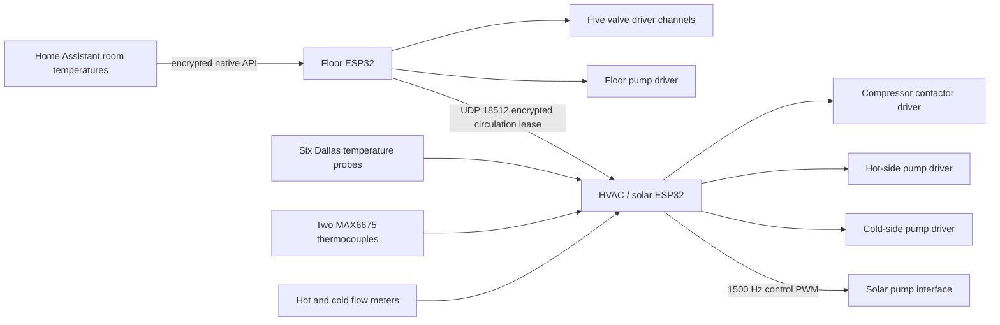

# Wiring map

This map follows the YAML and C++ source synchronized on 2026-10-27. Wire colours, terminal numbering, load voltages, contactor coil ratings and the exact hydraulic port connections cannot be established from software. Check them against the installed hardware. Do not assume a generic relay board has the same active polarity.

## Floor controller (`nodemcu-32s`)

| GPIO | Function | Electrical logic in source |
|---|---|---|
| 33 | Bathroom valve driver | Active LOW |
| 32 | Kitchen valve driver | Active LOW |
| 14 | Living-room valve driver | Active LOW |
| 9 | Bedroom valve driver | Active LOW; board-specific caveat below |
| 27 | Corridor valve driver | Active LOW |
| 26 | Floor circulation pump driver | Active LOW |

**GPIO9 caveat:** it is connected to flash on many ESP32-WROOM/NodeMCU boards. The published map preserves the installed source; it is not a recommendation to use GPIO9 on an arbitrary ESP32. Verify the exact module and move the channel to a suitable free GPIO if necessary.

Each GPIO goes to a compatible relay/driver input. Valve and pump power is switched by the relay contacts or suitable power stage. Room temperature readings come from Home Assistant, not wired temperature inputs on this controller. The five `platform: homeassistant` room entities must match the receiving HA installation. The optional CSI extension uses the ESP32 Wi-Fi radio and adds no GPIO wiring.

## HVAC / solar controller (`esp32dev`)

| GPIO | Connection | Notes |
|---|---|---|
| 2 | Dallas 1-Wire data bus | Six DS18B20 addresses in YAML; pull data up to 3.3 V through approximately 4.7 kΩ |
| 17 | Dallas power-control signal | Active HIGH, `ALWAYS_ON`; verify the external power stage, do not assume this pin can power all probes directly |
| 1 | MAX6675 SCK | Shared software SPI; UART TX conflicts avoided by `logger.baud_rate: 0` |
| 3 | MAX6675 SO / MISO | Shared software SPI; UART RX pin |
| 18 | Backup-tank MAX6675 CS | K-type thermocouple; source applies +2°C calibration |
| 22 | Solar-collector MAX6675 CS | K-type thermocouple; source applies −10°C calibration |
| 36 | Hot-loop flow pulses | Input-only GPIO, no internal pull-up |
| 39 | Cold-loop flow pulses | Input-only GPIO, no internal pull-up |
| 25 | Compressor driver | Active HIGH; always off at boot |
| 14 | Hot-side pump driver | Active HIGH; always off at boot |
| 27 | Cold-side pump driver | Active HIGH; always off at boot |
| 4 | Compressor-cooling auxiliary output | Active LOW; always off at boot, no automatic actuation in this snapshot |
| 0 | Solar pump control PWM | 1500 Hz LEDC, 0–100%; use the pump's required signal interface |
| 23 | Alarm indicator | GPIO output; use a current-limiting resistor or suitable driver |

GPIO0 and GPIO2 are strapping pins: connected interfaces must not force an invalid boot level. GPIO1/3 also serve flashing/UART functions. Flow outputs must be 3.3 V compatible; open-collector sensors need an external pull-up to 3.3 V. Use level conversion for higher-voltage outputs. Connect signal grounds where required by the driver/interface design; preserve isolation where the hardware provides it.

The solar output is a **control signal**, not power for a pump. A Grundfos-type PWM control input must be wired using that model's electrical specification; do not infer polarity, voltage or stop behaviour from the ESP32 duty cycle alone.

### Temperature probe roles

| YAML ID | Physical measurement |
|---|---|
| `coldin` | Cold-loop heat-exchanger inlet; −0.125°C relative correction |
| `cold` | Cold-loop heat-exchanger outlet |
| `hotin` | Hot-loop heat-exchanger inlet; +3.375°C relative correction |
| `hot` | Hot-loop heat-exchanger outlet |
| `motortemp` | Compressor body temperature |
| `tanktemp` | Main storage-tank probe; source identifies it as the bottom probe |
| `tank_temp2` | Independent backup tank thermocouple |
| `collector_temp` | Solar collector thermocouple |

Dallas ROM addresses identify the original physical probes. Replace them with discovered addresses and verify the association by changing one probe's temperature at a time. The offsets are installation calibration, not universal sensor corrections. The backup tank probe is exposed for observation; the current controllers use `tanktemp` for their tank decisions and do not automatically substitute the backup value.

The original installation description includes two plate heat exchangers, a buried cold loop, solar collectors and a two-coil 300 L tank. The exact coil/port arrangement, refrigerant circuit, mains wiring and independent cut-out chain require an on-site schematic; they are deliberately not invented here.
